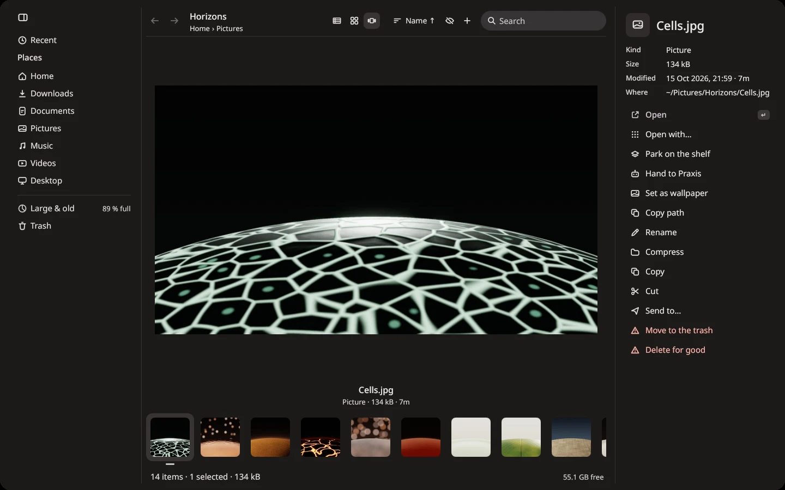
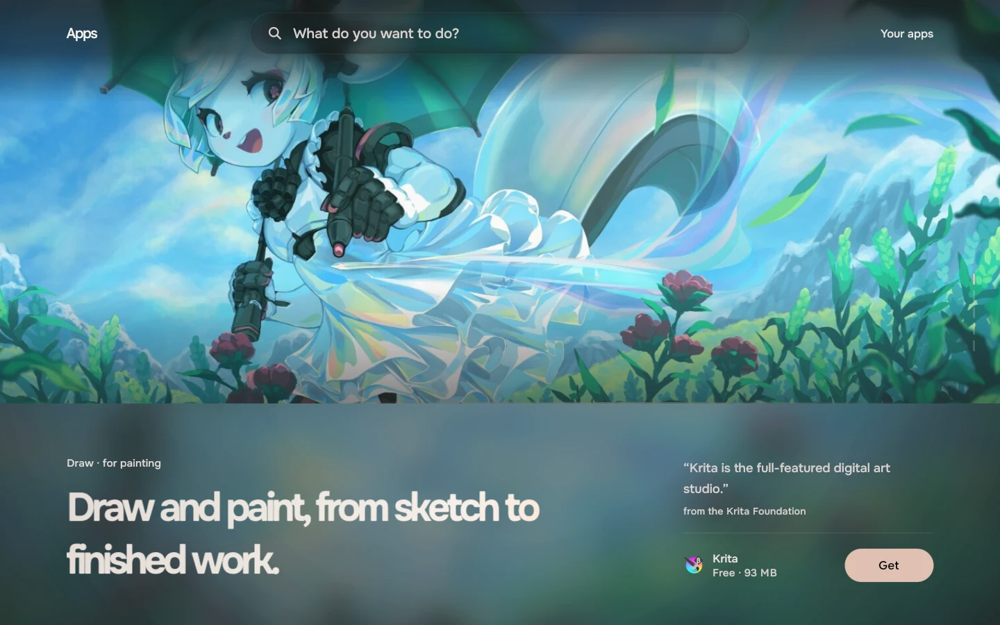

# Tacit

Tacit is an operating system (a Linux distro) for laptops and desktops. Its desktop, apps, browser,
typefaces and icons are its own and made to fit together. Underneath, it's Arch Linux.

[Download](https://tacitos.co/install) · [tacitos.co](https://tacitos.co) · [Release notes](https://tacitos.co/release-notes) · [Discord](https://discord.gg/Geg72FUhY)

## What's in it

- A notch at the top of the screen. When something finishes, it says so in one line, then goes quiet.
- A search that finds apps, files, settings and sums, and hands anything else to the web or to your agent.
- **Pinax** for files, **Viewer** for photos, video and PDFs, **Graphis** for code, and **Settings**.
- **Thyris**, a browser on Chrome's engine that blocks ads and trackers.
- **Apps**, with more than 1,300 apps. Say what you want to do and it suggests what to use.
- **Praxis**, for an AI agent if you want one: Claude Code, Codex, opencode or pi, with your own account.
- Updates download in the background and install while the computer restarts, tonight or right away, without a
  password.

## Installing

Try Tacit from a USB stick first; nothing on your computer changes until you choose to install. Setup installs it
next to Windows, shrinking Windows to make room, or instead of it. The [install guide](https://tacitos.co/install)
goes through it step by step.

## This repository

The desktop and its apps. The browser is in [thyris](https://github.com/ciscobugger/thyris), and how Tacit's packages
and installer are made is in [tacit-build](https://github.com/ciscobugger/tacit-build). To build and run the desktop
yourself, see [DEVELOPING.md](DEVELOPING.md).

## Thanks

Tacit is built on Arch Linux, Hyprland and Quickshell. Its desktop began as a fork of
[end-4's dots-hyprland](https://github.com/end-4/dots-hyprland).

Licence: GPL-3.0
