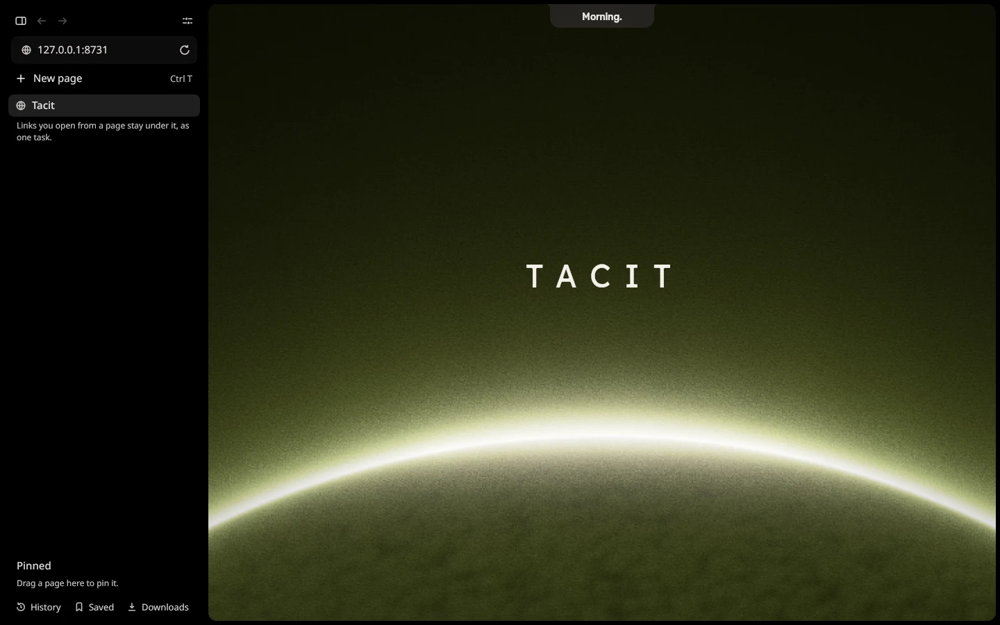

# Thyris

**Tacit's browser.**

Thyris runs on Chrome's engine, so sites work as they do in Chrome. It blocks ads and trackers with uBlock Origin Lite
and keeps Google's AI features off. Your pages sit in a list beside the page, and links you open from a page stay
under it, as one task.

It comes with [Tacit](https://tacitos.co); this repository is its source. It's made with Qt Quick and the Chromium
Embedded Framework.

Licence: GPL-3.0
